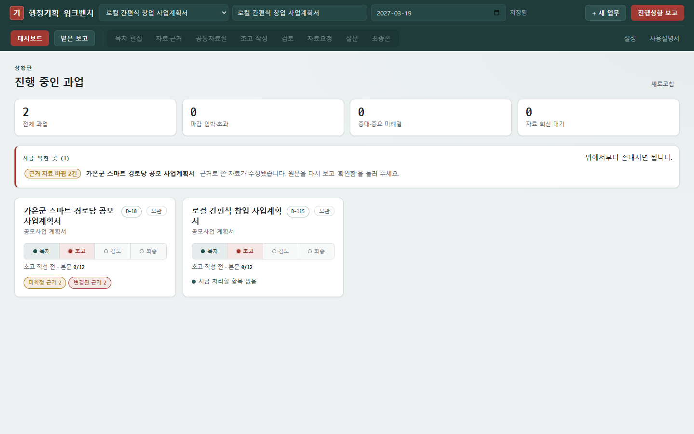
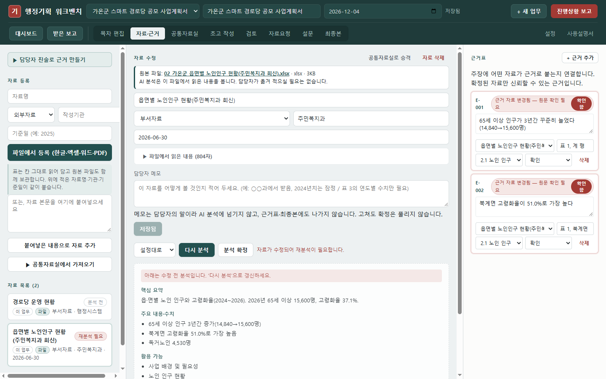
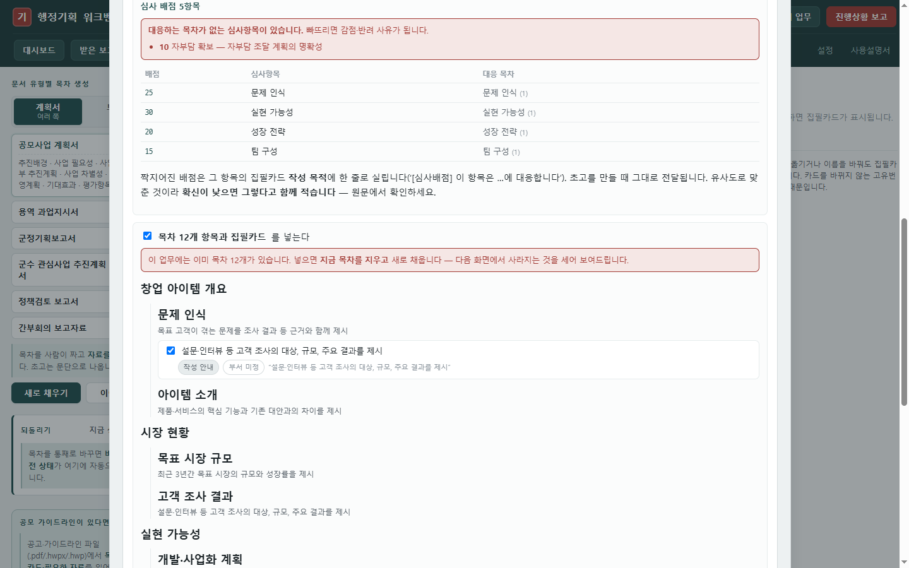

# AI 행정기획 워크벤치

**공고·요구사항에 맞춰, 근거로 통제된 문서를 쓰는 도구.**
공고문을 읽어 목차와 심사 배점을 세우고, 사람이 확정한 근거로만 초고를 쓰고,
검토자는 의견만 냅니다. 자료조사 → 초고 → 검토 → 최종본 전 과정을 한 화면에서 다룹니다.
로컬에서 도는 단일 사용자 도구입니다(FastAPI + React + SQLite). 한글(hwp·hwpx) 문서를 읽고 씁니다.



### 누가 쓰는가

처음엔 군청 기획 담당자를 위해 만들었습니다. 그런데 "공고를 받아 근거를 갖춰 계획서를 쓴다"는
일은 훨씬 많은 사람이 합니다.

| 쓰는 사람 | 쓰는 문서 | 모의데이터 |
|---|---|---|
| 지방자치단체 기획 담당자 | 공모사업 계획서, 군정기획보고서, 간부회의 자료 | [`모의데이터/`](./모의데이터) |
| 지원사업에 신청하는 창업·중소기업 | 창업·R&D·바우처 사업계획서 | [`모의데이터/창업지원/`](./모의데이터/창업지원) |
| 용역업체·컨설팅사 | 지자체 공모 대행, 연구용역 보고서 | — |
| 비영리단체·공공기관 | 보조금 신청서, 결과보고서, 기관 평가 보고서 | — |

### 다른 AI 문서 도구와 다른 점

- **AI 는 제안하고, 사람이 확정합니다.** 초고는 제안이고, 본문 채택은 사람이 합니다.
- **확정하기 전엔 근거가 아닙니다.** 자료 → AI 분석 → 사람의 확정을 거쳐야 근거가 됩니다.
  자료가 바뀌면 그 자료를 쓴 근거마다 **'원본이 바뀌었다'** 신호가 뜨고, 사람이 확인해야만 꺼집니다.



- **빠뜨린 것을 짚습니다.** 공고의 심사 배점표와 목차를 맞춰 보고, 대응하는 목차가 없는
  심사항목을 빨간 칸으로 알려 줍니다. AI 키 없이 규칙만으로도 됩니다.



- **실패를 숨기지 않습니다.** AI 호출이 실패하면 다른 모델로 몰래 넘기지 않고 그대로 알립니다.

<sub>스크린샷은 모의데이터(가상 자료)로 찍었습니다. 자료 분석 내용은 시연용 예시 응답입니다.</sub>

---

## 돌려 보는 방법

**접속 주소:** 실행하면 브라우저가 자동으로 열립니다. 열리지 않으면 주소창에 직접 넣으세요.

| 실행 방법 | 주소 |
|---|---|
| ⓪ 포터블 꾸러미(`실행.bat`) · ② `python run.py` | `http://127.0.0.1:8000` |
| ① `2_START.bat`(개발 서버) | `http://localhost:5173` |

이 도구는 **외부 서버에 우리 데이터를 두지 않습니다.** 자료는 PC 안의 SQLite 파일
하나(`backend/data/workbench.db`)에 들어가고, 바깥으로 나가는 통신은 설정한 AI 회사의
API 호출뿐입니다.

### 기능 한눈에

- **자료실** — 한글(hwp/hwpx)·PDF·엑셀·워드를 읽어 들이고, AI 분석을 거쳐
  **사람이 확정한 것만 '근거'가 됩니다**(확정 전에는 근거가 아닙니다).
- **목차·집필카드** — 문서 유형별 목차 틀. 항목마다 "무엇을 빠뜨리면 안 되는지"를 적어 둡니다.
- **초고** — 확정한 근거 안에서만 쓰게 하거나(엄격), 연결문장을 허용하되 추측을 표시합니다.
- **검토** — 사실확인·기술·구조·비평 네 검토자가 **의견만** 냅니다. 본문을 직접 고치지 않습니다.
- **공모 가이드라인** — 공고문을 읽어 목차·심사 배점·필요한 자료를 제안합니다(채택은 사람이).
- **최종본** — 근거 부록을 붙인 `.docx`, 또는 기관 고유 한글(HWPX) 양식에 채워 내보내기.
- **진행상황 보고** — 시스템이 센 사실로 보고 파일을 만들고, 사람은 확인하고 한마디 덧붙입니다.

### 실행 — 셋 중 하나

**⓪ 아무것도 설치하지 않고 (윈도우, 권장)**

릴리스(Releases)에 올린 **`행정기획워크벤치_포터블.zip`**(준비 중 — 그전에는 ②로 직접 만듭니다)을 받아 풀고, 안의 `실행.bat` 을
더블클릭합니다. 파이썬과 필요한 패키지가 폴더 안에 들어 있어 설치도 인터넷도 필요 없습니다
(AI 기능만 AI 회사에 접속합니다). 행정망 PC 에 반입하는 방식이 이것입니다.

**① 파이썬·Node 가 있는 PC**

```
1_SETUP.bat      (최초 1회 — venv + npm 설치, 인터넷 필요)
2_START.bat      (백엔드 8000 + 프런트 5173, 브라우저 자동 열림)
```

필요: Python 3.11+, Node.js 18+. `.bat` 이 막히면 아래 '빠른 시작'의 명령을 그대로 쓰면 됩니다.

**② 포터블 꾸러미를 직접 만들기**

```
portable\포터블_만들기.bat     ← 인터넷 되는 윈도우 PC 에서 1회, 수 분 걸립니다
→ '행정기획워크벤치_포터블' 폴더와 같은 이름의 .zip 이 생깁니다. 폴더 안의 실행.bat 더블클릭
```

저장소에는 화면 빌드 결과(`frontend/dist`)를 넣지 않으므로, 이 저장소에서 바로 만들려면
**Node.js 18+ 가 필요합니다**(스크립트가 화면을 빌드해 담습니다). 파이썬은 따로 받아 담으므로
PC 에 없어도 됩니다.

### AI 키가 없어도 됩니다

키가 없어도 앱은 정상으로 뜨고, **AI 가 아닌 기능은 전부 동작합니다**(자료 읽기·목차·근거
확정·내보내기·진행상황). AI 기능만 "키가 없습니다"로 **분명히** 실패합니다 — 조용히
다른 모델로 넘어가지 않습니다.

AI 를 보시려면 화면 맨 위 **설정 → AI 연결**에서 키를 넣고 **‘시험’** 을 누르면 됩니다
(저장 즉시 반영, 프로그램을 다시 켜지 않습니다). OpenAI·Claude·Gemini, 그리고 기관이
올려 둔 **OpenAI 호환 서버**(엑사원·솔라·젬마 등 행정안전부 AI 공통기반 지원 모델)를
주소만 넣어 붙일 수 있습니다. 넣은 키는 이 PC 의 DB 에만 저장되며 포터블 꾸러미에
딸려가지 않습니다.

### 시연용 모의데이터

[`모의데이터/`](./모의데이터) 폴더에 가상의 공모사업 한 건(공고 hwpx · 부서 회신 xlsx · 행정시스템
내려받기 xls · 실태조사 docx · 담당자 진술 · 정정 공고)이 있습니다. 어떤 파일을 어디에 올리는지와
시연 흐름 네 가지는 [`모의데이터/안내.txt`](./모의데이터/안내.txt)에 있습니다.

[`모의데이터/창업지원/`](./모의데이터/창업지원)에는 지자체가 아닌 예로, 창업기업이 지원사업에 신청하는
경우(모집 공고 hwpx · 시장 규모와 고객 설문 xlsx · 대표자 진술)가 있습니다. 실제로 있는 사업을 본뜬 것이 아닙니다.

모두 지어낸 자료이며 개인정보가 없습니다.

---

> **개발을 이어받는 분(사람/클로드)은 먼저 [`CLAUDE.md`](./CLAUDE.md)를 읽으세요.**
> 설계 원칙·구조·지금까지의 결정·주의사항이 모두 거기 있습니다.
> 그 원칙과 충돌하는 변경은 하지 않습니다.
> 기여하시려면 [`CONTRIBUTING.md`](./CONTRIBUTING.md)(사람용 요약)부터 보셔도 됩니다.
> 테스트: `cd backend && pip install -r requirements-dev.txt && python -m pytest`

## 빠른 시작 (개발 PC)

필요: Python 3.11+, Node.js 18+

```
# 백엔드
cd backend
python -m venv .venv
.venv\Scripts\pip install -r requirements.txt      # (mac/linux: .venv/bin/pip)
copy .env.example .env                              # 필요한 provider 키만 채움
python run.py                                       # http://127.0.0.1:8000 (API + 빌드된 프런트)

# 프런트(개발서버, 별도 터미널)
cd frontend
npm install
npm run dev                                         # http://localhost:5173 (/api → 8000 프록시)
```

Windows에서는 `1_SETUP.bat`(최초 1회) → `2_START.bat`(두 창 실행)도 사용 가능.

## 배포 (행정망, 설치 없이)

`portable/포터블_만들기.bat`를 **인터넷 되는 윈도우 PC**에서 1회 실행 →
`행정기획워크벤치_포터블` 폴더 생성 → 행정망 PC로 반입 → `실행.bat` 더블클릭.
자세한 내용은 `portable/사용설명.txt`.

## 구조 한눈에

- `backend/app/main.py` FastAPI 진입점(+ 빌드된 프런트 서빙)
- `backend/app/db.py` SQLite 스키마·마이그레이션(목차 uid에 카드/근거를 묶어 보존)
- `backend/app/routers/` projects·outline·resources·library·review·requests·
  export·dashboard·report·inbox
- `backend/app/providers/` LLM 어댑터(openai/claude/gemini + 호환 서버, registry로 교체)
- `backend/app/agents/` 검토 서브에이전트(사실확인·기술·구조·비평)
- `frontend/src/` React 화면(App + 각 Room + Dashboard/Inbox/ReportModal)

자세한 설계 맥락은 **`CLAUDE.md`**.

## 라이선스

[MIT](./LICENSE). 함께 쓰는 패키지(fastapi·python-docx·openpyxl·pypdf 등)는 각자의 라이선스를 따릅니다.
